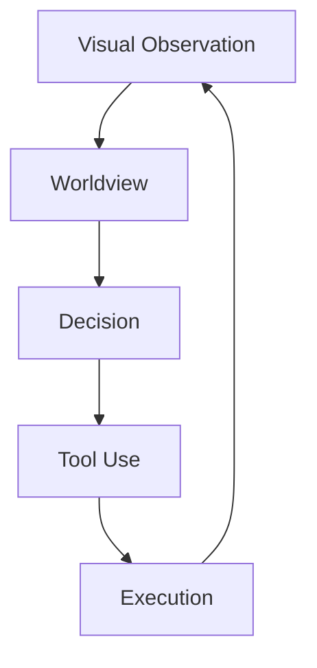

<a id="top"></a>

# 第4阶段：Innovation / 创新假设

Maintained: **2026-10-25**.

本阶段必须遵守根目录的 [研究契约](../SSOT.md)、[agent 规则](../AGENTS.md) 和 [全局流程](../PROCESS.md)。当前项目阶段由 [`../STATUS.md`](../STATUS.md) 唯一确定；目录存在不代表该阶段已启动或产出已通过。

## 当前状态与归属

候选想法可以登记；当前没有被采纳或冻结的核心假设。目录内的历史想法不代表通过研究闸门。

本阶段先在本文件内维护结构化条目；需要多个方向时按方向命名文件，直接更新其最新状态。每项工作通过来源、方法、假设或运行 ID 连接其他阶段的证据，不复制整篇上游文档，也不生成日期补丁或每次进展的新文件。

<a id="topic-research-innovation"></a>

## Stage 4 — Innovation

### Original Hypotheses and Algorithm Design

Source record updated: 2026-10-14

**Status:** IDEAS MAY BE RECORDED; NO CORE HYPOTHESIS IS CURRENTLY FROZEN.

Innovation is where Clover may finally propose its own representation, algorithm or learning principle. It must be downstream of Research, Analysis and Synthesis.

### Innovation record template

```text
Idea name:
Status: IDEA / HYPOTHESIS / TESTABLE / REJECTED / SUPERSEDED

Observed gap:
Evidence for the gap:
Existing approaches considered:
Why existing approaches appear insufficient:

Original hypothesis:
Mathematical statement:
State / representation:
Learning signal:
Update rule:
Memory rule:
Uncertainty semantics:
Action relationship:

Prediction:
Falsifier / kill condition:
Minimal discriminating experiment:
Required baseline:
Expected advantage:
Expected cost / risk:
```

### Rules

- Novelty must be algorithmic or scientific, not merely a new arrangement of named modules.
- If a new variable is introduced, every dependent equation and definition must be updated consistently.
- A hypothesis should explain an observed failure, not merely sound elegant.
- Historical Clover concepts may appear here, but only as candidates.
- An idea does not become the project answer until Evaluation supports it against strong alternatives.

### Historical idea bucket

Examples of historical concepts that may be re-examined here include field/crystallization, CSP/SEP, evidence state, licence/auditability, evidence replay, growth/revision, visual world compiler and related ideas.

Their historical existence is not evidence of correctness.

### Preferred innovation form

```text
field evidence
→ unresolved contradiction
→ simplest new hypothesis capable of resolving it
→ mathematical formulation
→ experiment that can kill it
```

This stage is the proper home for “our own ideas.”

---

## 候选假设与既有记录


Historical and current candidate ideas with their falsifiers. Inclusion is not adoption, implementation or validation.

以下记录维护候选假设的当前状态；来源日期限定其证据，不能把本次结构调整当作新验证。

## Contents

- [Clover Hypotheses After the Research Reset](#topic-research-survey-clover_hypotheses)
- [Hypothesis — Explicit vs Distributed Latent World State](#topic-docs-hypotheses-explicit-vs-latent)
- [Hypothesis — Field Crystallization](#topic-docs-hypotheses-field-crystallization)
- [Hypothesis — Epistemic Licences](#topic-docs-hypotheses-licences)
- [Hypothesis — Machine-Native World Primitives](#topic-docs-hypotheses-machine-native-primitives)
- [Hypothesis — Spacetime World Representation](#topic-docs-hypotheses-spacetime-world)
- [Hypothesis — World Growth](#topic-docs-hypotheses-world-growth)

<a id="topic-research-survey-clover_hypotheses"></a>

## Clover Hypotheses After the Research Reset

Source record updated: 2026-10-14

Strong internal ideas from pre-reset Clover notes, retained **as hypotheses, not commitments**.

Filtering rule:

```text
external evidence / internal contradiction
→ identify the real problem
→ derive a Clover-native candidate
→ define falsifier
→ only later decide whether to implement
```

### H1 — Evidence Replay / Dual Memory
Compressed world state may discard evidence later needed for a new query or contradiction. Candidate: keep visual evidence memory distinct from current world state and replay selectively for local revision.

External pressure: VISTA https://arxiv.org/abs/2610.02200

Falsifier: learned recurrent/contextual state matches or exceeds long-occlusion continuity, belief revision and memory cost without replay.

### H2 — Visual World Compiler
Candidate abstraction:

```text
visual history
→ evidence / IR
→ spatial-temporal structure
→ world representation
→ query/action-facing state
```

with selective invalidation/re-analysis after new evidence. This is a dependency/provenance abstraction, not a commitment to compiler-shaped software.

Falsifier: a unified learned world model handles revision, queries and provenance more simply/robustly.

### H3 — Query-Sufficient Representation
Compression/pruning may remove information required later. Candidate principle: a transform may be lossy, but must preserve distinctions needed by the query/task family it claims to support.

Relevant evidence: V-JEPA predictive abstraction, ReWAM https://arxiv.org/abs/2609.38163, VISTA.

Falsifier: representations that fail the proposed sufficiency diagnostics nevertheless generalize and act better in full embodied evaluation.

### H4 — Query-Conditioned Temporal Persistence
Evidence, object identity, place state and task state operate at different timescales. Retention may need to depend on state/query/dynamics rather than one history window.

Compare flat history, fixed hierarchy, learned recurrent memory and adaptive persistence.

Falsifier: adaptive persistence gives no capability/memory advantage at matched compute.

### H5 — Separate Epistemic State from Verification State
Do not collapse world uncertainty, confidence, calibration, claim validity and provenance lifecycle.

Even if old Licence machinery disappears, “what the system knows” and “whether a particular assertion artifact remains valid” may need separate semantics.

Falsifier: simpler unified probabilistic state provides equal correctness, revision, refusal and planning without semantic confusion.

### H6 — Proof-Carrying / Auditable Assertions
Long-horizon robots can act on stale/origin-unknown beliefs. Candidate: important assertions carry compact evidence/state dependencies or provenance.

Compare with Bayesian belief only, calibrated confidence, event sourcing and implicit state + audit logs.

Falsifier: explicit provenance adds latency/complexity without improving recovery, safety, debugging or long-horizon correctness.

### H7 — Counter-Witness-First Causality

```text
expected world
→ observation disagrees
→ locate minimum broken dependency
→ causal candidate
→ test by prediction/intervention
```

Connects prediction error, revision and causal discovery.

Falsifier: no intervention-prediction gain over ordinary learned dynamics.

### H8 — Epistemic Compute Scheduling
Use unresolved evidence, conflict, change, query relevance and expected information gain to decide where/how much to compute — not to decide truth.

Falsifier: negligible end-to-end savings or unstable semantics.

### H9 — Sparse Visual Event IR
Keep RGB as scientific input, derive sparse change/prediction-residual evidence internally.

External evidence: https://arxiv.org/abs/2602.23204

Falsifier: loses world/query information or worsens total latency.

### H10 — Geometry as Proposal / Heuristic
World geometry should reduce downstream search/decision cost, e.g. proposal ordering or reachability heuristics, without becoming a second decision authority.

Falsifier: no planning/generalization benefit at matched correctness.

### H11 — Static / Dynamic Verification Compilation
If explicit checking survives, static invariant structure might be precompiled while current evidence supplies a small dynamic witness.

Falsifier: verification is not core or precompilation gives no meaningful benefit.

### H12 — State-Transition Affordance
Avoid category→action lookup. Compare required world change with predicted capability effect:

```text
ΔW_goal
vs
ΔW_tool
→ compatibility / affordance
```

Falsifier: direct learned policy transfers better to novel objects/tasks at equal data/compute with no explicit transformation benefit.

### H13 — Type as Transformation Equivalence
Machine type may be a reusable equivalence class over geometry, motion response, interaction, deformability and affordance rather than a human category name.

Falsifier: semantic categories or distributed features transfer better to unseen objects/actions.

### H14 — Active Perception as Unknown→Action Bridge

```text
ambiguity
→ candidate visual action
→ expected information gain
→ look/move/inspect
→ updated world
```

External pressure: Vantage https://arxiv.org/abs/2610.11810

Falsifier: passive context/memory reaches equal reliability/task success.

### H15 — Worldview Value Must Be Proven Through Action
An explicit worldview is valuable only if it improves unseen-scene transfer, sample efficiency, planning/search, world-change recovery, unjustified-action rate, long-horizon success or diagnosis/revision.

Critical eventual comparison:

```text
strong policy
vs
matched policy + Clover world representation
```

This is a required falsifier for the explicit-worldview program itself.

### Promotion rule

Before promotion, a hypothesis needs operational definitions, prior-art comparison, a discriminating experiment, kill condition, action-relevance argument, compute implications and evidence that it unifies rather than adds a side path.

The correct outcome may be to merge, transform or delete several hypotheses.

---

<a id="topic-docs-hypotheses-explicit-vs-latent"></a>

## Hypothesis — Explicit vs Distributed Latent World State

**Status:** `OPEN`

This is deliberately framed as a contest rather than a Clover commitment.

### Explicit-state hypothesis

A typed, persistent world state may improve:

- queryability;
- auditability;
- belief revision;
- causal intervention;
- downstream planning;
- efficient sparse updates.

### Distributed-latent hypothesis

Large video/world models may represent useful physical variables in distributed high-dimensional codes that are more expressive and easier to learn from scale.

Meta's work on interpreting physics in video world models is an important counterweight to assuming compact explicit variables are necessary:

https://ai.meta.com/research/publications/interpreting-physics-in-video-world-models/

### Research test

Future comparison should hold visual evidence and tasks as constant and compare representation quality on:

- persistence/identity;
- physical and causal queries;
- intervention and belief revision;
- generalization;
- planning usefulness;
- compute/memory.

The project should accept hybrid outcomes if evidence supports them.

---

<a id="topic-docs-hypotheses-field-crystallization"></a>

## Hypothesis — Field Crystallization

**Status:** `RESEARCH_PROTOTYPE`

### Question

Can local visual evidence self-organize under a small set of dynamics into stable structures that correspond to useful world entities and relations?

### Intuition

The original Clover intuition combines puzzle fragments, charge-like local evidence and field/potential dynamics: fragmented evidence interacts and stabilizes into larger structures rather than relying exclusively on category-first detection.

### Current claim boundary

Existing implementation work shows that a field/crystallization mechanism can be constructed and used as part of a world prototype. It has **not** established that stable crystallization is equivalent to correct world structure or that this representation is superior to learned latent/object/geometry alternatives.

### Critical competing explanations

- ordinary connected components / tracking;
- object-centric slots;
- learned dense video representations;
- explicit learned geometry;
- segmentation + tracking pipelines.

### Falsifier

If field crystallization provides no independent gain in identity, relation, physical prediction, generalization or downstream decision under controlled complexity/compute, it should not remain a core mechanism merely because the analogy is elegant.

---

<a id="topic-docs-hypotheses-licences"></a>

## Hypothesis — Epistemic Licences

**Status:** `RESEARCH_PROTOTYPE`

### Question

Can machine-verifiable authority envelopes make world assertions safer to consume, easier to invalidate and easier to audit without becoming a second notion of confidence?

### Current idea

A licence binds a claim to evidence/dependencies/version/proof so downstream modules can distinguish an authoritative assertion from stale or revoked state.

### Important semantic boundary

Licence is **not** probability, confidence or uncertainty. If evidence is insufficient for a claim, the clean design may be to refuse to mint the claim rather than encode uncertainty as a licence state.

### Why it may matter

- dependency-scoped invalidation;
- auditability;
- stale propagation;
- reproducible decision premises.

### Competing explanation

Ordinary typed state + provenance + calibrated uncertainty may provide equivalent value with lower complexity.

### Falsifier

If licences do not improve correctness under stale/contradictory state, auditability or decision safety enough to justify their runtime/engineering cost, they should be simplified or removed.

---

<a id="topic-docs-hypotheses-machine-native-primitives"></a>

## Hypothesis — Machine-Native World Primitives

**Status:** `OPEN`

### Question

Is there a small primitive family that can compose from local visual evidence into entities, regions and task-relevant world structure while remaining efficient and queryable?

### Motivation

Traditional systems often change representation at every level: pixels → points → voxels → objects → scene graph → task state. A unified primitive family could reduce semantic impedance and improve update efficiency.

### Candidate properties

A candidate primitive may need some subset of:

- spatiotemporal support;
- extent/scale;
- evidence/belief;
- observability;
- local dynamics;
- identity/lineage;
- authority/provenance handle.

No field list is frozen.

### Competing explanations

- dense learned latent representation;
- explicit geometry + semantic layers;
- object slots;
- scene graphs;
- generative spatial world models.

### Falsifier

If unification requires growing special-case fields or performs worse than specialized representations on query expressibility, update cost and generalization, the unified-primitive hypothesis should be rejected.

---

<a id="topic-docs-hypotheses-spacetime-world"></a>

## Hypothesis — Spacetime World Representation

**Status:** `RESEARCH_PROTOTYPE`

### Question

Should identity and world state be represented as structures continuous through time rather than as independent per-frame detections linked afterward?

### Motivation

Object permanence, occlusion and causal continuity are intrinsically temporal. A representation in which time is part of structure may avoid repeatedly reconstructing identity from isolated frames.

### Competing explanation

Strong frame-level representation + association/tracking may already be sufficient.

### Falsifier

If a spacetime-native representation produces no robust benefit over a strong detection/segmentation + tracking baseline on long occlusion, reappearance, split/merge, relation change and downstream query consistency, the stronger spacetime claim should be rejected.

---

<a id="topic-docs-hypotheses-world-growth"></a>

## Hypothesis — World Growth

**Status:** `OPEN`

### Question

Can the robot's world representation grow and revise during operation rather than remaining a frozen ontology learned only offline?

### Desired operations

- add;
- merge;
- split;
- revise;
- retire;
- forget;
- consolidate.

### Key requirement

Growth is not simply accumulating memory. New evidence must be capable of correcting an earlier wrong belief or abstraction.

### Competing approaches

- continual neural fine-tuning;
- episodic retrieval without ontology change;
- frozen foundation model + external memory;
- Bayesian state/model adaptation.

### Falsifier

If online growth introduces instability or catastrophic corruption without measurable gains in novel-object/world adaptation, the current growth mechanism is not sufficient.

---

<a id="topic-docs-architecture-readme"></a>

## Candidate system decomposition

**Status: INTERNAL_HYPOTHESIS / not adopted.** This is a proposed responsibility split, not an established interface or a constraint on the answer. Compare it with end-to-end, latent and other competing organizations before adoption.

### System-level model



- **Worldview** — forms and updates world claims from visual evidence.
- **Decision** — turns goals plus world information into desired state changes/subgoals.
- **Tool Use** — selects capabilities that may realize those changes.
- **Execution** — carries out capabilities and returns new observations.

### Architecture rule

Candidate engineering question: would explicit public interfaces improve correctness and traceability relative to an otherwise matched system? No module topology or private-state restriction is adopted during Stage 1.

See [candidate authority chain](#topic-docs-architecture-authority-chain).

---

<a id="topic-docs-architecture-authority-chain"></a>

## Authority Chain

**Status: INTERNAL_HYPOTHESIS / unvalidated.** No prototype evidence in this public repository establishes this authority design. The numbered items below are candidate design principles to test, not additional SSOT requirements.

The intended direction is:

```text
visual evidence
→ world state / world assertions
→ public queries
→ optional authority/provenance envelope
→ decision premises
→ action selection
→ execution trace
→ new visual evidence
```

### Principles

1. **One world authority** — caches and derived views must not silently become competing truth stores.
2. **No downstream private-truth bypass** — Decision should not gain special access unavailable through the Worldview contract.
3. **Observation re-enters through perception** — execution feedback should not directly write world truth.
4. **Unknown is not free/absent** — lack of observation is an epistemic condition.
5. **Provenance is not confidence** — evidence lineage and uncertainty have different semantics.

The exact licence mechanism and the authority design both remain hypotheses. A later proposal must name the failure addressed, compare competing state/interface designs and specify a falsifier; provenance and uncertainty alone do not establish one required module topology.


---

## 假设审计与可执行实验规约（2026-11-02 序列五.3 填充）

### 1. 全量审计与合并裁决（H1–H15 + 6 个旧假设）

审计口径：陈述是否可证伪、falsifier 是否已记录（registry/hypotheses.yaml)、与其它假设是否重叠、最小实验是否已规约。历史条目不删除（AGENTS §15 出处与反驳史保留），合并只发生在**实验层**。

| 条目 | 可证伪性 | 与其它条目重叠 | 裁决 |
|---|---|---|---|
| H1 Evidence Replay / Dual Memory | 有 falsifier | 与 H5（验证态分离）共享写回通道；与旧「World Growth」重叠 | 保留；与 H5 共用实验 3（分开记账：H1 记召回，H5 记污染） |
| H2 Visual World Compiler | 有 falsifier | 与 H9（事件 IR 是其输入层）、旧「Machine-Native Primitives」重叠 | 保留；编译层实验待 IR 稳定后置，本轮只测 H9 输入层 |
| H3 Query-Sufficient Representation | 有 falsifier | 与旧「Explicit vs Latent」的 latent 侧部分重叠 | 保留；探针实现已落地（ReversibilityProbe)，本轮 EV0 诊断见实验 2 附带读数 |
| H4 Query-Conditioned Temporal Persistence | 有 falsifier | 与 H1 共享记忆底座；与旧「Spacetime」的时间侧重叠 | 保留；与 H1 共用实验 3 的长遮挡臂 |
| H5 Separate Epistemic/Verification State | 有 falsifier | 与 H1、旧「World Growth」重叠 | 保留；实验 3 的污染率臂即其判决 |
| H6 Proof-Carrying Assertions | 有 falsifier | 旧「Epistemic Licences」是其治理形态 | **实验层合并**：Licences 不再单独设实验，其许可语义由 H6 的 depends_on 审计链 + 非对称门控实现（DualMemoryReplay 已含）；假设条目保留待独立证据 |
| H7 Counter-Witness-First Causality | 有 falsifier | 与 H14（取证行动选择其见证集）衔接 | 保留；本轮 EV0 单元级验证（定位精度，合成图）见 06-evaluation 附带读数 |
| H8 Epistemic Compute Scheduling | 有 falsifier | 与二.6 硬实时契约是同一主张的规约/假设两侧 | 保留；实验 4 判决 |
| H9 Sparse Visual Event IR | 有 falsifier | 旧「Field Crystallization」的事件侧直觉在此操作化；与 H2 输入层重叠 | 保留；实验 4 的事件臂 + 稀疏率读数判决 |
| H10 Geometry as Proposal | 有 falsifier | 与 R2 的关系是「降格使用」而非竞争 | 保留；本轮 PLANNED（需几何工件本地可跑，Tier-0 候选 DA3-SMALL 待权重） |
| H11 Static/Dynamic Verification Compilation | 有 falsifier | 与 H6 的审计链衔接（编译期验证 vs 运行期证明） | 保留；本轮 PLANNED |
| H12 State-Transition Affordance | 有 falsifier | 与 H13（类型=变换等价）相邻：H13 给 H12 的兼容性提供类型判据 | 保留；本轮 EV0 单元读数（compatibility/delta_w 合成例）见 06-evaluation |
| H13 Type as Transformation Equivalence | 有 falsifier | 与 H12 相邻（见上） | 保留；本轮 PLANNED（与 H12 接触实验合并设计） |
| H14 Active Perception as Unknown→Action Bridge | 有 falsifier | 消费 H7 见证集与 G2 不可识别输出 | 保留；本轮 EV0 单元读数（select_evidence_action 拒绝不可逆探针）+ 实验 5 的取证臂 |
| H15 Worldview Value Through Action | 有 falsifier | 旧「Explicit vs Latent」是其母问题形态 | **实验层合并**：Explicit vs Latent 不再单独设实验，其裁决 = T6/实验 5 的崩溃曲线；条目保留为出处 |
| 旧 Field Crystallization | 有 falsifier（原文） | 与 H9/H2 重叠（见上） | 保留为历史假设；其事件侧主张由 H9 实验承接，场结晶本体主张维持 OPEN 不冻结 |
| 旧 Machine-Native Primitives | 有 falsifier | 与 H2/H9/H13 三向重叠 | 保留；由 H9（事件原语）+ H13（变换类型）分拆承接，不再单独设实验 |
| 旧 Spacetime | 有 falsifier | 与 H4（时间）+ H9（事件）重叠 | 保留；由 H4 实验承接时间侧 |
| 旧 World Growth | 有 falsifier | 与 H1/H5 重叠 | 保留；由实验 3 承接 |

净化结果：21 个条目 → 15 个独立实验面（H1+H5 共面、H6+Licences 共面、H15+Explicit/Latent 共面、H9 承接 Field/Machine-Native 事件侧、H4 承接 Spacetime)，无条目被删除或静默降格。

### 2. 最小可执行实验规约（每假设一条；预算口径见二.1/二.7）

统一纪律：主要指标与 Kill 阈值先于运行登记（configs/preregistration_template.yaml)；证伪族 Holm-Bonferroni；n 按功效 ≥0.80 反推；episode 级独立。本轮实际执行 5 组（实验 1–5，见 06-evaluation)，覆盖 H1/H4/H5/H6（实验 3)、H8/H9（实验 4)、H15（实验 5)、B15 探针（实验 2 关联 H3）与压缩损伤（实验 1，AGENTS §24)。未执行者标 PLANNED 并给脚本路径占位。

| 假设 | 最小实验 | 对照组 | 预算 | n / 阈值 | 二元 Kill 条件 | 状态 |
|---|---|---|---|---|---|---|
| H1 | 实验 3：Equal-Byte 下长遮挡召回（合成） | 长上下文缓冲基线 vs 显式节点+重放 | Equal-Byte 双方同字节 | n=200 episodes/臂；α=0.05 Holm | 重放臂召回不优于基线（CI 含 0）→ Kill | 本轮执行（EV0) |
| H4 | 实验 3 长遮挡臂的查询条件子集 | 无条件全量保持基线 | 同上 | 同上 | 查询条件保持在长遮挡下无增益 → Kill | 本轮执行（EV0) |
| H5 | 实验 3：暗中篡改后 FP 写回污染率 | 无门控写回 vs 非对称门控 | 同上 | 同上 | 门控臂污染率不低于无门控（CI 含 0）→ Kill | 本轮执行（EV0) |
| H6 | 实验 3 附带：反证级联回滚完整性 | 无 depends_on 的平坦存储 | —（确定性检查） | 全部合成反证例 | 任一依赖断言未被降级 → 该实现 Kill（假设本身降级待修） | 本轮执行（EV0) |
| H8 | 实验 4：调度器 vs 固定管线（合成闭环） | 固定全量管线 | Equal-Latency 33.3ms | n=300 帧序列×5 seeds | P99 jitter 与成功率不优于固定管线 → Kill | 本轮执行（EV0) |
| H9 | 实验 4 事件臂：事件率-成功率曲线 | 稠密帧基线 | Equal-Byte | 同上 | 事件 IR 在同等成功率下字节不降 → Kill | 本轮执行（EV0) |
| H15 | 实验 5 / T6：反应式 vs 显式状态崩溃曲线 | 匹配参数/窗口的反应式基线 | Equal-Latency | 遮挡时长 5 档×n=100 | 全域无崩溃差异 → 反向 Kill（显式状态无独立增益） | 本轮执行（EV0 合成形态） |
| H3 | 实验 2 附带：未声明查询特征的线性可恢复率 | 声明内特征 | 探针容量协议内 | 合成特征 n=1000 | 两者 R² 无差异 → 「查询充分」主张 Kill | 本轮执行（EV0 诊断） |
| H2 | PLANNED：IR→可审计世界状态编译往返 | 直接潜状态基线 | Equal-Byte | 待登记 | — | PLANNED（scripts 占位：src/clover/innovation/sparse_event_ir.py 为输入层） |
| H7 | 本轮 EV0 单元读数 + PLANNED 图规模扩展 | 随机定位基线 | — | 合成图 n=50 | 定位精度不优于随机 → Kill | EV0 读数本轮 |
| H10 | PLANNED（待 DA3-SMALL 本地权重） | 几何作硬约束基线 | Tier-0 | 待登记 | — | PLANNED |
| H11 | PLANNED | 运行期检查基线 | — | 待登记 | — | PLANNED |
| H12 | 本轮 EV0 单元读数 + PLANNED 接触实验 | 语义可供性标签基线 | — | 待登记 | — | EV0 读数本轮 |
| H13 | PLANNED（与 H12 合并设计） | — | — | 待登记 | — | PLANNED |
| H14 | 本轮 EV0 单元读数 + 实验 5 取证臂 | 固定观察基线 | Equal-Latency | 并入实验 5 | 取证行动不降低不可识别误报 → Kill | EV0 读数本轮 |
