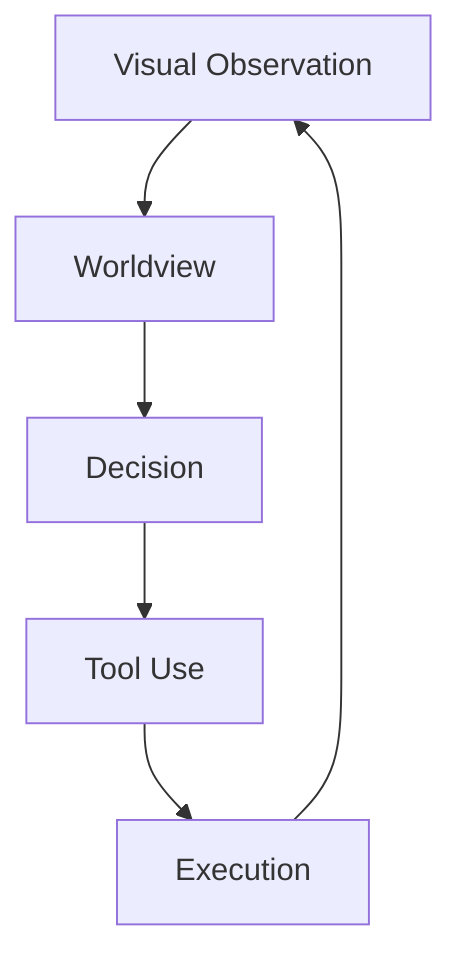

<a id="top"></a>

# Candidate hypotheses

Maintained: **2026-10-25** · Current project stage: **Research** ([status](STATUS.md)).

Historical and current candidate ideas with their falsifiers. Inclusion is not adoption, implementation or validation.

This is the canonical topic document. Update it in place; source-level dates and reading-depth labels below qualify the evidence, not the maintenance date.

## Contents

- [Clover Hypotheses After the Research Reset](#topic-research-survey-clover_hypotheses)
- [Hypothesis — Explicit vs Distributed Latent World State](#topic-docs-hypotheses-explicit-vs-latent)
- [Hypothesis — Field Crystallization](#topic-docs-hypotheses-field-crystallization)
- [Hypothesis — Epistemic Licences](#topic-docs-hypotheses-licences)
- [Hypothesis — Machine-Native World Primitives](#topic-docs-hypotheses-machine-native-primitives)
- [Hypothesis — Spacetime World Representation](#topic-docs-hypotheses-spacetime-world)
- [Hypothesis — World Growth](#topic-docs-hypotheses-world-growth)

<a id="topic-research-survey-clover_hypotheses"></a>

## Clover Hypotheses After the Research Reset

Source record updated: 2026-10-14

Strong internal ideas from pre-reset Clover notes, retained **as hypotheses, not commitments**.

Filtering rule:

```text
external evidence / internal contradiction
→ identify the real problem
→ derive a Clover-native candidate
→ define falsifier
→ only later decide whether to implement
```

### H1 — Evidence Replay / Dual Memory
Compressed world state may discard evidence later needed for a new query or contradiction. Candidate: keep visual evidence memory distinct from current world state and replay selectively for local revision.

External pressure: VISTA https://arxiv.org/abs/2610.02200

Falsifier: learned recurrent/contextual state matches or exceeds long-occlusion continuity, belief revision and memory cost without replay.

### H2 — Visual World Compiler
Candidate abstraction:

```text
visual history
→ evidence / IR
→ spatial-temporal structure
→ world representation
→ query/action-facing state
```

with selective invalidation/re-analysis after new evidence. This is a dependency/provenance abstraction, not a commitment to compiler-shaped software.

Falsifier: a unified learned world model handles revision, queries and provenance more simply/robustly.

### H3 — Query-Sufficient Representation
Compression/pruning may remove information required later. Candidate principle: a transform may be lossy, but must preserve distinctions needed by the query/task family it claims to support.

Relevant evidence: V-JEPA predictive abstraction, ReWAM https://arxiv.org/abs/2609.38163, VISTA.

Falsifier: representations that fail the proposed sufficiency diagnostics nevertheless generalize and act better in full embodied evaluation.

### H4 — Query-Conditioned Temporal Persistence
Evidence, object identity, place state and task state operate at different timescales. Retention may need to depend on state/query/dynamics rather than one history window.

Compare flat history, fixed hierarchy, learned recurrent memory and adaptive persistence.

Falsifier: adaptive persistence gives no capability/memory advantage at matched compute.

### H5 — Separate Epistemic State from Verification State
Do not collapse world uncertainty, confidence, calibration, claim validity and provenance lifecycle.

Even if old Licence machinery disappears, “what the system knows” and “whether a particular assertion artifact remains valid” may need separate semantics.

Falsifier: simpler unified probabilistic state provides equal correctness, revision, refusal and planning without semantic confusion.

### H6 — Proof-Carrying / Auditable Assertions
Long-horizon robots can act on stale/origin-unknown beliefs. Candidate: important assertions carry compact evidence/state dependencies or provenance.

Compare with Bayesian belief only, calibrated confidence, event sourcing and implicit state + audit logs.

Falsifier: explicit provenance adds latency/complexity without improving recovery, safety, debugging or long-horizon correctness.

### H7 — Counter-Witness-First Causality

```text
expected world
→ observation disagrees
→ locate minimum broken dependency
→ causal candidate
→ test by prediction/intervention
```

Connects prediction error, revision and causal discovery.

Falsifier: no intervention-prediction gain over ordinary learned dynamics.

### H8 — Epistemic Compute Scheduling
Use unresolved evidence, conflict, change, query relevance and expected information gain to decide where/how much to compute — not to decide truth.

Falsifier: negligible end-to-end savings or unstable semantics.

### H9 — Sparse Visual Event IR
Keep RGB as scientific input, derive sparse change/prediction-residual evidence internally.

External evidence: https://arxiv.org/abs/2602.23204

Falsifier: loses world/query information or worsens total latency.

### H10 — Geometry as Proposal / Heuristic
World geometry should reduce downstream search/decision cost, e.g. proposal ordering or reachability heuristics, without becoming a second decision authority.

Falsifier: no planning/generalization benefit at matched correctness.

### H11 — Static / Dynamic Verification Compilation
If explicit checking survives, static invariant structure might be precompiled while current evidence supplies a small dynamic witness.

Falsifier: verification is not core or precompilation gives no meaningful benefit.

### H12 — State-Transition Affordance
Avoid category→action lookup. Compare required world change with predicted capability effect:

```text
ΔW_goal
vs
ΔW_tool
→ compatibility / affordance
```

Falsifier: direct learned policy transfers better to novel objects/tasks at equal data/compute with no explicit transformation benefit.

### H13 — Type as Transformation Equivalence
Machine type may be a reusable equivalence class over geometry, motion response, interaction, deformability and affordance rather than a human category name.

Falsifier: semantic categories or distributed features transfer better to unseen objects/actions.

### H14 — Active Perception as Unknown→Action Bridge

```text
ambiguity
→ candidate visual action
→ expected information gain
→ look/move/inspect
→ updated world
```

External pressure: Vantage https://arxiv.org/abs/2610.11810

Falsifier: passive context/memory reaches equal reliability/task success.

### H15 — Worldview Value Must Be Proven Through Action
An explicit worldview is valuable only if it improves unseen-scene transfer, sample efficiency, planning/search, world-change recovery, unjustified-action rate, long-horizon success or diagnosis/revision.

Critical eventual comparison:

```text
strong policy
vs
matched policy + Clover world representation
```

This is a required falsifier for the explicit-worldview program itself.

### Promotion rule

Before promotion, a hypothesis needs operational definitions, prior-art comparison, a discriminating experiment, kill condition, action-relevance argument, compute implications and evidence that it unifies rather than adds a side path.

The correct outcome may be to merge, transform or delete several hypotheses.

---

<a id="topic-docs-hypotheses-explicit-vs-latent"></a>

## Hypothesis — Explicit vs Distributed Latent World State

**Status:** `OPEN`

This is deliberately framed as a contest rather than a Clover commitment.

### Explicit-state hypothesis

A typed, persistent world state may improve:

- queryability;
- auditability;
- belief revision;
- causal intervention;
- downstream planning;
- efficient sparse updates.

### Distributed-latent hypothesis

Large video/world models may represent useful physical variables in distributed high-dimensional codes that are more expressive and easier to learn from scale.

Meta's work on interpreting physics in video world models is an important counterweight to assuming compact explicit variables are necessary:

https://ai.meta.com/research/publications/interpreting-physics-in-video-world-models/

### Research test

Future comparison should hold visual evidence and tasks as constant and compare representation quality on:

- persistence/identity;
- physical and causal queries;
- intervention and belief revision;
- generalization;
- planning usefulness;
- compute/memory.

The project should accept hybrid outcomes if evidence supports them.

---

<a id="topic-docs-hypotheses-field-crystallization"></a>

## Hypothesis — Field Crystallization

**Status:** `RESEARCH_PROTOTYPE`

### Question

Can local visual evidence self-organize under a small set of dynamics into stable structures that correspond to useful world entities and relations?

### Intuition

The original Clover intuition combines puzzle fragments, charge-like local evidence and field/potential dynamics: fragmented evidence interacts and stabilizes into larger structures rather than relying exclusively on category-first detection.

### Current claim boundary

Existing implementation work shows that a field/crystallization mechanism can be constructed and used as part of a world prototype. It has **not** established that stable crystallization is equivalent to correct world structure or that this representation is superior to learned latent/object/geometry alternatives.

### Critical competing explanations

- ordinary connected components / tracking;
- object-centric slots;
- learned dense video representations;
- explicit learned geometry;
- segmentation + tracking pipelines.

### Falsifier

If field crystallization provides no independent gain in identity, relation, physical prediction, generalization or downstream decision under controlled complexity/compute, it should not remain a core mechanism merely because the analogy is elegant.

---

<a id="topic-docs-hypotheses-licences"></a>

## Hypothesis — Epistemic Licences

**Status:** `RESEARCH_PROTOTYPE`

### Question

Can machine-verifiable authority envelopes make world assertions safer to consume, easier to invalidate and easier to audit without becoming a second notion of confidence?

### Current idea

A licence binds a claim to evidence/dependencies/version/proof so downstream modules can distinguish an authoritative assertion from stale or revoked state.

### Important semantic boundary

Licence is **not** probability, confidence or uncertainty. If evidence is insufficient for a claim, the clean design may be to refuse to mint the claim rather than encode uncertainty as a licence state.

### Why it may matter

- dependency-scoped invalidation;
- auditability;
- stale propagation;
- reproducible decision premises.

### Competing explanation

Ordinary typed state + provenance + calibrated uncertainty may provide equivalent value with lower complexity.

### Falsifier

If licences do not improve correctness under stale/contradictory state, auditability or decision safety enough to justify their runtime/engineering cost, they should be simplified or removed.

---

<a id="topic-docs-hypotheses-machine-native-primitives"></a>

## Hypothesis — Machine-Native World Primitives

**Status:** `OPEN`

### Question

Is there a small primitive family that can compose from local visual evidence into entities, regions and task-relevant world structure while remaining efficient and queryable?

### Motivation

Traditional systems often change representation at every level: pixels → points → voxels → objects → scene graph → task state. A unified primitive family could reduce semantic impedance and improve update efficiency.

### Candidate properties

A candidate primitive may need some subset of:

- spatiotemporal support;
- extent/scale;
- evidence/belief;
- observability;
- local dynamics;
- identity/lineage;
- authority/provenance handle.

No field list is frozen.

### Competing explanations

- dense learned latent representation;
- explicit geometry + semantic layers;
- object slots;
- scene graphs;
- generative spatial world models.

### Falsifier

If unification requires growing special-case fields or performs worse than specialized representations on query expressibility, update cost and generalization, the unified-primitive hypothesis should be rejected.

---

<a id="topic-docs-hypotheses-spacetime-world"></a>

## Hypothesis — Spacetime World Representation

**Status:** `RESEARCH_PROTOTYPE`

### Question

Should identity and world state be represented as structures continuous through time rather than as independent per-frame detections linked afterward?

### Motivation

Object permanence, occlusion and causal continuity are intrinsically temporal. A representation in which time is part of structure may avoid repeatedly reconstructing identity from isolated frames.

### Competing explanation

Strong frame-level representation + association/tracking may already be sufficient.

### Falsifier

If a spacetime-native representation produces no robust benefit over a strong detection/segmentation + tracking baseline on long occlusion, reappearance, split/merge, relation change and downstream query consistency, the stronger spacetime claim should be rejected.

---

<a id="topic-docs-hypotheses-world-growth"></a>

## Hypothesis — World Growth

**Status:** `OPEN`

### Question

Can the robot's world representation grow and revise during operation rather than remaining a frozen ontology learned only offline?

### Desired operations

- add;
- merge;
- split;
- revise;
- retire;
- forget;
- consolidate.

### Key requirement

Growth is not simply accumulating memory. New evidence must be capable of correcting an earlier wrong belief or abstraction.

### Competing approaches

- continual neural fine-tuning;
- episodic retrieval without ontology change;
- frozen foundation model + external memory;
- Bayesian state/model adaptation.

### Falsifier

If online growth introduces instability or catastrophic corruption without measurable gains in novel-object/world adaptation, the current growth mechanism is not sufficient.

---

<a id="topic-docs-architecture-readme"></a>

## Candidate system decomposition

**Status: INTERNAL_HYPOTHESIS / not adopted.** This is a proposed responsibility split, not an established interface or a constraint on the answer. Compare it with end-to-end, latent and other competing organizations before adoption.

### System-level model



- **Worldview** — forms and updates world claims from visual evidence.
- **Decision** — turns goals plus world information into desired state changes/subgoals.
- **Tool Use** — selects capabilities that may realize those changes.
- **Execution** — carries out capabilities and returns new observations.

### Architecture rule

Candidate engineering question: would explicit public interfaces improve correctness and traceability relative to an otherwise matched system? No module topology or private-state restriction is adopted during Stage 1.

See [candidate authority chain](#topic-docs-architecture-authority-chain).

---

<a id="topic-docs-architecture-authority-chain"></a>

## Authority Chain

**Status: INTERNAL_HYPOTHESIS / unvalidated.** No prototype evidence in this public repository establishes this authority design. The numbered items below are candidate design principles to test, not additional SSOT requirements.

The intended direction is:

```text
visual evidence
→ world state / world assertions
→ public queries
→ optional authority/provenance envelope
→ decision premises
→ action selection
→ execution trace
→ new visual evidence
```

### Principles

1. **One world authority** — caches and derived views must not silently become competing truth stores.
2. **No downstream private-truth bypass** — Decision should not gain special access unavailable through the Worldview contract.
3. **Observation re-enters through perception** — execution feedback should not directly write world truth.
4. **Unknown is not free/absent** — lack of observation is an epistemic condition.
5. **Provenance is not confidence** — evidence lineage and uncertainty have different semantics.

The exact licence mechanism and the authority design both remain hypotheses. A later proposal must name the failure addressed, compare competing state/interface designs and specify a falsifier; provenance and uncertainty alone do not establish one required module topology.
