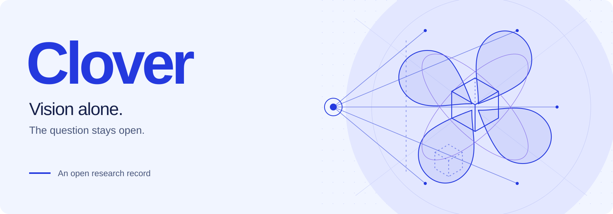

  

  <a href="README.md">English</a> &nbsp; / &nbsp;
  <a href="SSOT.md">研究问题</a> &nbsp; / &nbsp;
  <a href="STATUS.md">当前进度</a> &nbsp; / &nbsp;
  <a href="01-research/sources-and-resources.md">文献来源</a>

# 机器如何仅凭视觉理解真实世界？

这是 Clover 的研究问题。长期目标是构建一个通用机器人“大脑”：通过视觉形成对真实世界的理解，再据此决策和行动。**问题固定，答案开放。**

**当前阶段：前期调研。** 我们正在重建问题、研究相互竞争的解释，并逐项追溯证据。最终表示、基础模型和核心算法尚未确定。研究进展与未解决问题统一记录在 [`STATUS.md`](STATUS.md)。

## 从这里开始

| 先读 | 内容 |
|---|---|
| [`SSOT.md`](SSOT.md) | 研究问题、理解的定义与证据纪律。 |
| [`STATUS.md`](STATUS.md) | 当前结论、剩余缺口与下一步工作。 |
| [第一阶段调研](01-research/README.md) | 研究版图，以及证据仍然薄弱的地方。 |

## 沿着问题阅读

| 问题 | 持续更新的主题文档 |
|---|---|
| 视觉证据究竟能辨识什么？ | [观测、几何与物理](01-research/perception-and-identifiability.md) · [研究问题](01-research/research-questions.md) |
| 机器应当记住世界的哪些信息？ | [状态、表示与记忆](01-research/representation-and-memory.md) |
| 什么时候应该再看一眼、干预或修正认识？ | [因果、行动与开放世界](01-research/causality-and-active-perception.md) |
| 数据与训练怎样改变能力？ | [学习与数据](01-research/learning-and-data.md) |
| 基础模型和部署系统分别贡献了什么？ | [模型、运行时与工程](01-research/foundation-models-and-systems.md) |
| 什么证据能区分相互竞争的答案？ | [评测与资源](01-research/evaluation-and-benchmarks.md) · [一手来源](01-research/sources-and-resources.md) |
| 哪些 Clover 想法仍需经受检验？ | [候选假设](04-innovation/README.md) · [研究流程](PROCESS.md) |

## 阶段目录

| 阶段 | 唯一阶段入口 | 内容归属 |
|---|---|---|
| 1. Research / 调研 | [01-research/](01-research/README.md) | 调研方向、来源、资源、证据边界与未解问题 |
| 2. Analysis / 分析 | [02-analysis/](02-analysis/README.md) | 逐方法机制、假设、混淆与复现分析 |
| 3. Synthesis / 综合 | [03-synthesis/](03-synthesis/README.md) | 统一口径比较、能力/失败矩阵与证据缺口 |
| 4. Innovation / 创新 | [04-innovation/](04-innovation/README.md) | 原创假设、数学表述、预言、反证与候选想法 |
| 5. Implementation / 实现 | [05-implementation/](05-implementation/README.md) | 代码、依赖、配置、实现状态与可复现入口 |
| 6. Evaluation / 评测 | [06-evaluation/](06-evaluation/README.md) | 实验注册、协议、测量、结果、消融与失败 |
| 7. Reflection / 反思 | [07-reflection/](07-reflection/README.md) | 解释证据、更新假设状态与下一轮问题 |

## 把证据说清楚

部署时只输入视觉，与知识只从视觉中学得，是两个需要分别证明的命题。我们同时记录观测协议（`V0–V3`）与学习来源（`L0–L4`）。预测、重建、物理辨识和有效行动，各自需要相应证据。具体规则见 [`SSOT.md`](SSOT.md)。

调研 → 分析 → 综合 → 创新 → 实现 → 评测 → 反思。

跨阶段规则留在根目录；各阶段成果放入对应编号目录，第一阶段内部按调研方向维护一份当前正文。直接更新原文，旧状态保留在 Git 历史中。贡献者和 agent 从 [`AGENTS.md`](AGENTS.md) 开始，再按 [`PROCESS.md`](PROCESS.md) 工作。

[许可证](LICENSE) · [引用元数据](CITATION.cff)
