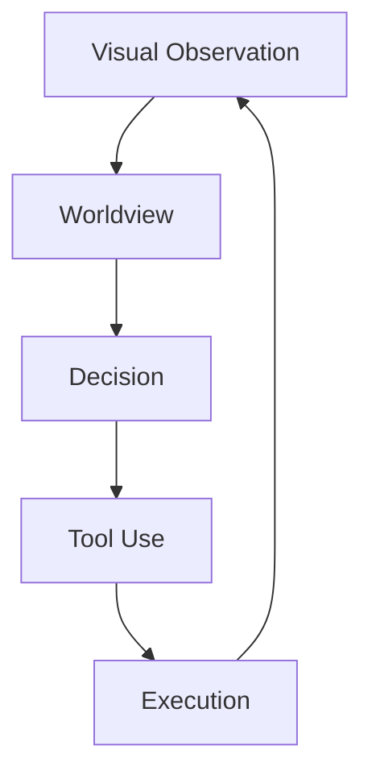

# Architecture

Architecture documentation describes the **current system-level decomposition and contracts**. It is not a claim that the internal representation is final.

## System-level model

- **Worldview** — forms and updates world claims from visual evidence.
- **Decision** — turns goals plus world information into desired state changes/subgoals.
- **Tool Use** — selects capabilities that may realize those changes.
- **Execution** — carries out capabilities and returns new observations.

## Architecture rule

Downstream modules should consume explicit public contracts rather than private upstream state. When implementation code is imported, this directory will document actual crate/module dependencies and current data flow.

See [Authority Chain](authority-chain.md).
