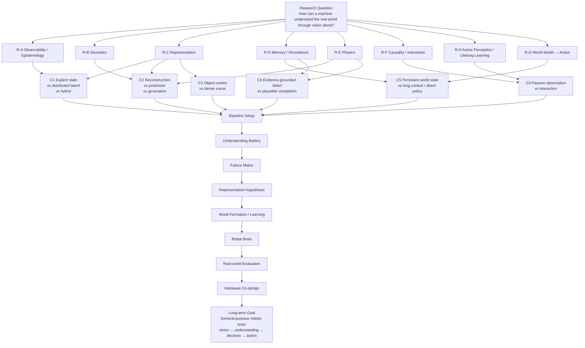
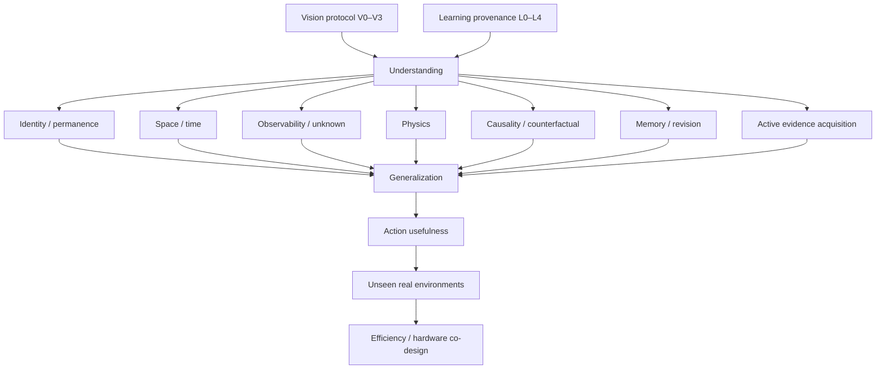

# Clover Research Overview Map

Last updated: 2026-10-14  
Phase: **Background Research / Problem Reconstruction**

> **Research question:** How can a machine understand the real world through vision alone?
>
> **Long-term goal:** Build a general-purpose robotic brain that forms an understanding of the real world through vision alone, then uses that understanding to decide and act.

This page is the compact visual index for the current research program. It is a map of questions and evidence flow, **not** a proposed Clover architecture.

## 1. Research flow



## 2. Eight research domains

| ID | Domain | Core question | Current dossier |
|---|---|---|---|
| R-A | Observability / Epistemology | What can pixels establish, and what remains unknown or ambiguous? | [`../dossiers/R-A-observability-epistemology.md`](../dossiers/R-A-observability-epistemology.md) |
| R-B | Geometry | What spatial structure is already solved by classical/learned geometry? | [`../dossiers/R-B-geometry.md`](../dossiers/R-B-geometry.md) |
| R-C | Representation | Explicit, latent, object-centric, dense or hybrid? | [`../dossiers/R-C-representation.md`](../dossiers/R-C-representation.md) |
| R-D | Memory / Persistence | How should a machine remember, forget and revise a partially visible world? | [`../dossiers/R-D-memory-persistence.md`](../dossiers/R-D-memory-persistence.md) |
| R-E | Physics | What separates plausible motion from quantitatively/relationally correct physics? | [`../dossiers/R-E-physics.md`](../dossiers/R-E-physics.md) |
| R-F | Causality / Interaction | What can observation identify, and what requires intervention? | [`../dossiers/R-F-causality-interaction.md`](../dossiers/R-F-causality-interaction.md) |
| R-G | World ↔ Action | Does a persistent worldview beat strong VLA/WAM/direct-policy baselines? | [`../dossiers/R-G-world-action.md`](../dossiers/R-G-world-action.md) |
| R-H | Active Perception / Lifelong | Can the system seek evidence and keep learning without corrupting old knowledge? | [`../dossiers/R-H-active-perception-lifelong.md`](../dossiers/R-H-active-perception-lifelong.md) |

## 3. Six primary contradictions

### C1 — Explicit state vs distributed latent vs hybrid

Primary evidence:

- V-JEPA 2 / 2.1 — predictive distributed state;
- Interpreting Physics in Video World Models — high-dimensional physical population codes;
- Identifiable World Models — distributed generative state plus identifiable coordinates;
- historical Clover — explicit/queryable-state hypothesis.

### C2 — Reconstruction vs prediction vs generation

Primary evidence:

- VGGT / VGGT-Ω — reconstruction;
- V-JEPA — predictive latent;
- Atlas / Cosmos — generative simulation;
- RoboPhys-3D — generated-video fidelity is not sufficient state/action evidence.

### C3 — Object-centric vs dense scene representation

Primary evidence:

- Slot Attention / PLATO — object-centric inductive bias;
- DINOv3 — strong dense distributed representation;
- SAM 3.1 — strong visible entity tracking baseline.

### C4 — Passive observation vs interaction

Primary evidence:

- large-scale video SSL;
- interventional causal representation learning;
- action-conditioned V-JEPA / WAM systems;
- active perception and self-play.

### C5 — Persistent world state vs long context / direct policy

Primary evidence:

- PersistBench / S-EMBER / VISTA;
- OpenVLA / π0.5;
- Helix 2.5 / Skild S1 reported generalization;
- WAM systems.

### C6 — Evidence-grounded belief vs plausible completion

Primary evidence:

- VISTA / evidence retrieval;
- Atlas / Cosmos generative world models;
- Principia / RoboPhys-3D physical-state evaluation;
- unknown/unobserved diagnostics.

## 4. Evidence pipeline

```mermaid
flowchart LR
    S["Primary / official source"] --> CL["What is actually demonstrated?"]
    CL --> LIM["What is not demonstrated?<br/>confounds / limitations"]
    LIM --> CON["Which Clover contradiction does it constrain?"]
    CON --> BL["Best comparator / baseline"]
    BL --> TEST["Discriminating experiment"]
    TEST --> FM["Failure Matrix"]
    FM --> DEC["Only then: architecture / representation decision"]
```



## 5. Evaluation flow



## 6. Baseline setup target

The first systematic baseline reconstruction should span **different representation families**, not many variants of one family:

```text
classical explicit geometry
static self-supervised visual representation
predictive video representation
learned geometry foundation model
visible entity tracking
persistent memory / retrieval
strong VLM embodied reasoning
open VLA / direct policy
world-action model
```

Candidate references currently include:

```text
ORB-SLAM3 / RAFT
DINOv3
V-JEPA 2 / 2.1
VGGT / VGGT-Ω
SAM 3.1
PersistBench / S-EMBER / VISTA-style memory comparisons
Gemini Robotics ER 2
OpenVLA
ReWAM / Being-M0.7-class WAMs
```

The exact executable set depends on reproducibility, compute and licensing; scientific coverage takes priority over local-hardware convenience.

## 7. Understanding Battery role

The Battery is a measurement instrument, not the project objective.

Current diagnostic families include:

```text
IntPhys 2
Minimal Video Pairs
CausalVQA
Perception Test
PersistBench
S-EMBER
Principia
QuantiPhy
RoboPhys-3D
custom occlusion/reappearance
custom unknown/unobserved
custom world revision
custom intervention twins
custom active perception
custom novel dynamics
long-horizon embodied recovery
```

## 8. Failure Matrix

For every baseline/representation, record failures separately rather than collapsing them into one score:

```text
geometry
identity
object permanence
temporal continuity
observability / unknown
memory / retrieval
revision
physics
causality / intervention
active perception
generalization
action / planning
recovery
latency
memory
energy when measurable
```

## 9. Decision boundary

A next-generation Clover representation is **not allowed to become the project answer** until the evidence flow reaches:

```text
broad background research
+ strong cross-family baselines
+ common Understanding Battery
+ explicit Failure Matrix
→ unresolved contradiction shared by existing approaches
→ candidate representation
→ falsifier
```

The correct outcome may be an explicit representation, distributed representation, hybrid, or no separate worldview at all.

---

**Protect the question, not the current answer.**
