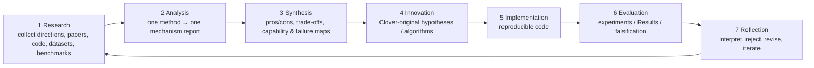
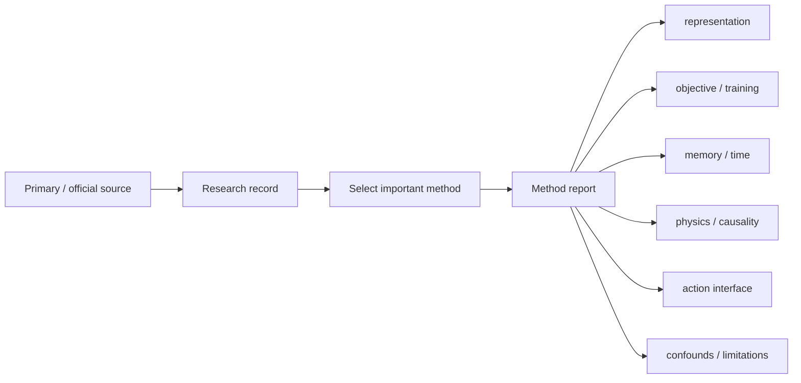
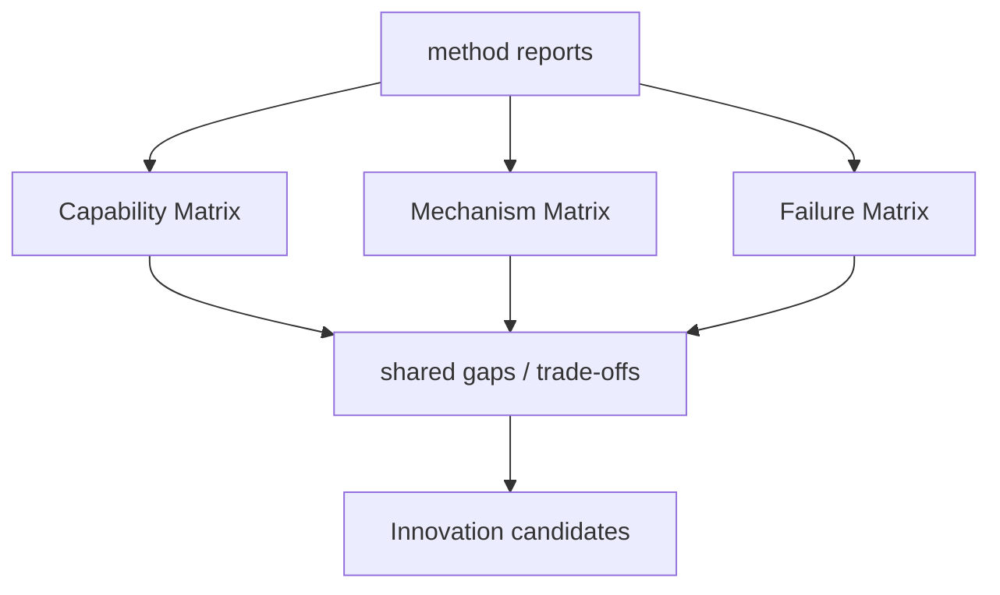

# Clover Research Overview Map

Last updated: 2026-10-14

> **Research question:** How can a machine understand the real world through vision alone?
>
> **Long-term goal:** Build a general-purpose robotic brain that forms an understanding of the real world through vision alone, then uses that understanding to decide and act.

This page is a compact visual index. It is a research map, not a proposed Clover architecture.

## 1. Canonical lifecycle



**Current active stage: Research.**

The earlier baseline / Understanding Battery / Failure Matrix concepts remain important, but they are now treated as research assets inside this lifecycle rather than top-level project phases:

- baseline catalog and baseline reproduction support Research/Analysis;
- Understanding Battery belongs primarily to Evaluation design;
- Failure Matrix is built during Synthesis from Analysis/Evaluation evidence.

## 2. Stage-1 research map

```mermaid
flowchart TD
    Q["Mother Question<br/>How can a machine understand the real world through vision alone?"]

    Q --> O["Observability / epistemology"]
    Q --> G["Geometry / motion / 3D / 4D"]
    Q --> V["Visual representation / SSL / video"]
    Q --> ENT["Objects / relations / semantic maps"]
    Q --> MEM["Memory / permanence / revision"]
    Q --> PHY["Physics / dynamics"]
    Q --> CAU["Causality / intervention"]
    Q --> ACT["Active perception / system identification"]
    Q --> WM["World models / generative simulation"]
    Q --> RA["VLA / WAM / robot foundation models"]
    Q --> CTRL["Planning / control / POMDP"]
    Q --> LIFE["OOD / continual / lifelong learning"]
    Q --> DATA["Datasets / simulators / benchmark design"]

    O --> INV["Research inventory"]
    G --> INV
    V --> INV
    ENT --> INV
    MEM --> INV
    PHY --> INV
    CAU --> INV
    ACT --> INV
    WM --> INV
    RA --> INV
    CTRL --> INV
    LIFE --> INV
    DATA --> INV
```



The active inventory is [`../RESEARCH.md`](../RESEARCH.md), which intentionally contains more directions than the eight older deep dossiers.

## 3. Detailed domain notes

The existing eight dossiers remain useful deep notes:

| ID | Domain | Dossier |
|---|---|---|
| R-A | Observability / Epistemology | [`../dossiers/R-A-observability-epistemology.md`](../dossiers/R-A-observability-epistemology.md) |
| R-B | Geometry | [`../dossiers/R-B-geometry.md`](../dossiers/R-B-geometry.md) |
| R-C | Representation | [`../dossiers/R-C-representation.md`](../dossiers/R-C-representation.md) |
| R-D | Memory / Persistence | [`../dossiers/R-D-memory-persistence.md`](../dossiers/R-D-memory-persistence.md) |
| R-E | Physics | [`../dossiers/R-E-physics.md`](../dossiers/R-E-physics.md) |
| R-F | Causality / Interaction | [`../dossiers/R-F-causality-interaction.md`](../dossiers/R-F-causality-interaction.md) |
| R-G | World Model ↔ Action | [`../dossiers/R-G-world-action.md`](../dossiers/R-G-world-action.md) |
| R-H | Active Perception / Lifelong | [`../dossiers/R-H-active-perception-lifelong.md`](../dossiers/R-H-active-perception-lifelong.md) |

They are topic notes, not project stages and not an exhaustive ontology.

## 4. Research → Analysis transition



The method-report template is in [`../ANALYSIS.md`](../ANALYSIS.md).

## 5. Analysis → Synthesis transition



A gap should be supported by comparison across strong methods, not merely by absence from one paper.

## 6. Innovation gate

A Clover-original algorithm should follow:

```text
broad Research
+ deep Analysis
+ comparative Synthesis
→ demonstrated unresolved gap
→ original hypothesis
→ mathematical / algorithmic definition
→ prediction
→ falsifier
→ Implementation
→ Evaluation
→ Reflection
```

Historical Clover ideas are allowed as candidate hypotheses, but they do not skip this gate.

## 7. Evaluation assets

Candidate evaluation instruments currently include:

```text
IntPhys 2
Minimal Video Pairs
CausalVQA
Perception Test
PersistBench
S-EMBER
Principia
RoboPhys-3D
EmbodimentSemantic
custom occlusion / reappearance
custom unknown / unobserved
custom world revision
custom intervention twins
custom active perception
custom novel dynamics
long-horizon embodied recovery
```

The exact battery is an Evaluation design decision, not the definition of understanding.

## 8. Current research rule

During Stage 1, prefer adding a missing field, source, method, dataset or benchmark over prematurely narrowing the answer.

The correct current question is:

> **What relevant work have we still not understood or even discovered?**

---

**Research broadly. Analyze deeply. Synthesize comparatively. Innovate only from demonstrated gaps.**
